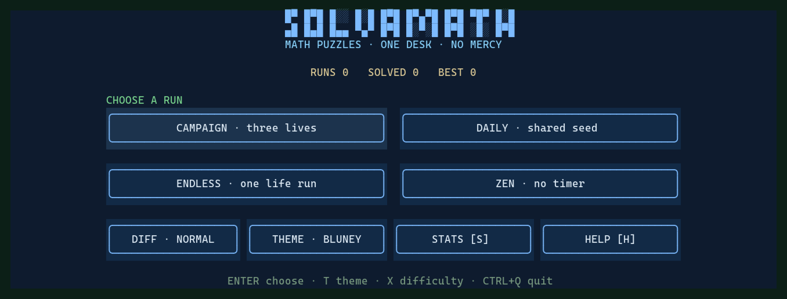
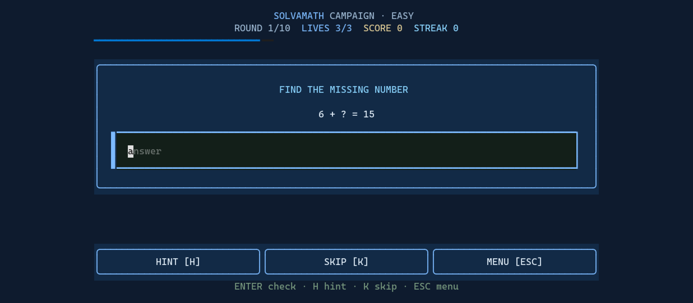

# Solvamath

<p align="center"></p>

A full-featured terminal math puzzle game built with **Python** and **Textual**.
Seven puzzle families, four run modes, four difficulties, a timer, streaks,
hints, achievements and a persistent local record — all in a fast TUI.

[](https://github.com/Mark44928/Solvamath/actions/workflows/ci.yml)
[](https://mark44928.github.io/Solvamath/)




## Install

```bash
pipx install git+https://github.com/Mark44928/Solvamath
solvamath
```

Or use the prefix-aware installer:

```bash
git clone https://github.com/Mark44928/Solvamath
cd Solvamath
bash install.sh
solvamath
```

It creates an isolated venv and links into `$PREFIX/bin` on Termux or
`~/.local/bin` on Linux. `--prefix DIR` overrides the launcher directory;
`--uninstall` removes the link and managed venv.

Or from a clone:

```bash
git clone https://github.com/Mark44928/Solvamath
cd Solvamath
python3 -m venv .venv
. .venv/bin/activate
pip install -e .
solvamath
```

## Play

| Mode | What changes |
|---|---|
| **Campaign** | 10 puzzles, three lives, timed |
| **Daily** | 10 puzzles, seeded by today's date, shared by everyone |
| **Endless** | Keep solving until the lives run out |
| **Zen** | 10 puzzles, no timer, no death |

Difficulties range from **Easy** to **Expert**. They change the number ranges,
puzzle mix, time limit and scoring. Themes: **Greenit**, **Bluney**, **Yellen**, **Nord**,
**Dracula** and **Mono**.

## Puzzle families

- **Equation** — solve for x.
- **Missing number** — find the hidden operand.
- **Operators** — fill the gaps in a left-to-right expression.
- **Sequence** — continue an arithmetic, geometric or square sequence.
- **True or false** — check an arithmetic statement.
- **Prime step** — find the next prime.
- **Make 24** — use all four numbers exactly once to reach 24.

Every answer is checked locally. Make 24 expressions are parsed by a small
AST-based evaluator; arbitrary code and names are rejected. No `eval()`.

## Scoring

Correct answers earn difficulty points and a time bonus. Streaks multiply the
reward up to **×5**. A hint halves that puzzle's reward. A wrong answer or a
timeout costs one life and resets the streak.

The menu keeps your best score, solved count and active theme. The Stats screen
shows accuracy, best streak, top scores and achievement badges. Data is stored
atomically in `~/.local/share/solvamath/state.json` (or under `$XDG_DATA_HOME`
when set).

## Controls

| Key | Action |
|---|---|
| `ENTER` | submit answer |
| `H` | hint |
| `K` | skip |
| `ESC` | back to menu |
| `T` | cycle theme |
| `X` | cycle difficulty |
| `CTRL+Q` | quit |

## CLI

```bash
solvamath --daily             # today's seeded run
solvamath --difficulty hard   # launch with a difficulty
solvamath --theme bluney      # launch with a theme
solvamath --stats             # print stats and exit
solvamath --seed 1234         # deterministic puzzle sequence for testing
solvamath --repl              # practice puzzles in a terminal REPL
```

## Development

```bash
make check
```

Runs Ruff, the full 16-test suite, the CLI version check and a headless stats
smoke test. The game core has no Textual imports and is tested separately.

## Screenshots

| Menu | Puzzle |
|---|---|
|  |  |

## 🛠️ More from Mark44928

- [SnakTUI](https://github.com/Mark44928/SnakTUI) — terminal Snake with ghosts and daily runs
- [CalculaHTML](https://github.com/Mark44928/CalculaHTML) — offline browser calculator
- [Plusalator](https://github.com/Mark44928/Plusalator) — C++17 calculator REPL
- [Pythonator](https://github.com/Mark44928/Pythonator) — pure-Python calculator REPL
- [Plusafetch](https://github.com/Mark44928/Plusafetch) — C++23 system fetch
- [pkg-manager](https://github.com/Mark44928/Easy-Termux-Package-Manager) — Termux package manager
- [NoNameOS](https://github.com/Mark44928/NoNameOS) — single-file C++ OS simulation
- [Greenit](https://github.com/Mark44928/Greenit) · [Bluney](https://github.com/Mark44928/Bluney) · [Yellen](https://github.com/Mark44928/Yellen) — terminal theme families
- [Android9-audios](https://github.com/Mark44928/Android9-audios) — stock Android sounds
- [Anti-bloatware](https://github.com/Mark44928/debloat-android-tv) — Android TV cleanup
- [android12-fastfetch](https://github.com/Mark44928/android12-fastfetch) — Android fetch config

## License

MIT.
